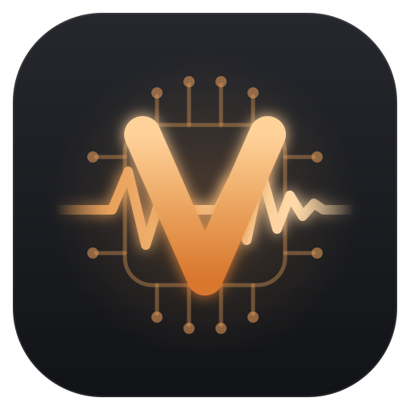
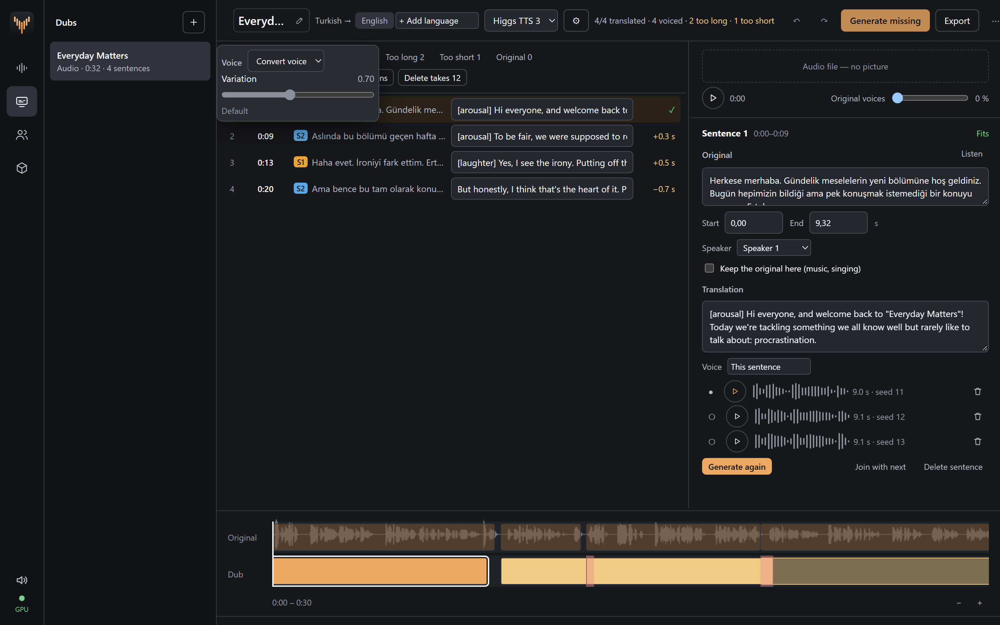
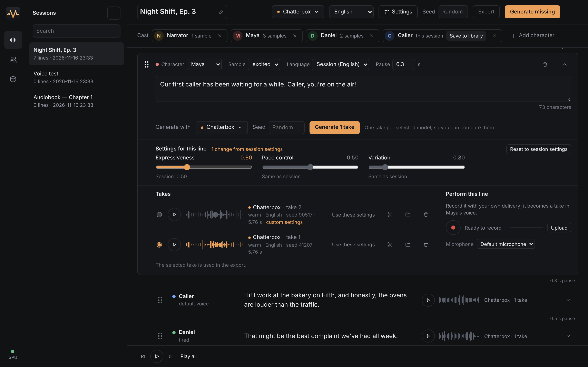
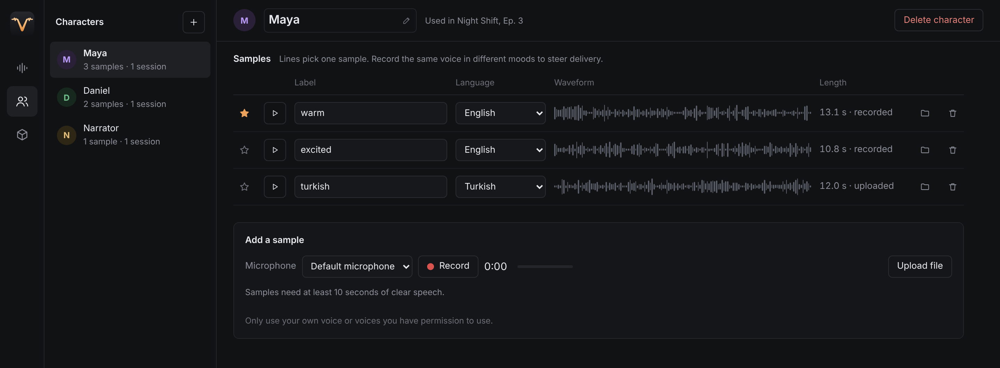
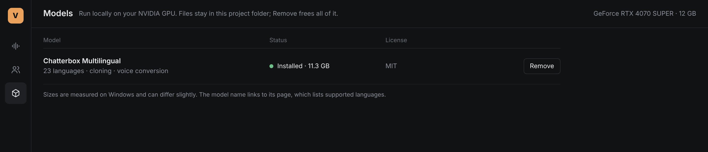

<p align="center"></p>

# Vokalit

**A local voice cloning, text-to-speech and dubbing studio.** Clone a voice from a short recording, voice a script
with several characters, or dub a video into another language in its speakers' own voices — all on your own computer
with an NVIDIA GPU. Your voice, your text and the generated audio never leave your machine.

It is deliberately small: plain Python and JavaScript, no build step, and models chosen to run on everyday graphics
cards with **8–12 GB of video memory** (developed on a 12 GB RTX 4070 SUPER).

**Listen** — two voices made with *Design voice* (no one's voice was recorded) in a short podcast voiced with Higgs
TTS 3, then the same voices reading it in English. Unmute the player to listen.

<table>
<tr><th>Turkish</th><th>English</th></tr>
<tr>
<td><video src="https://github.com/user-attachments/assets/3ae4f506-6cbf-43e7-b548-e0e4650fcc7b" controls muted width="100%"></video></td>
<td><video src="https://github.com/user-attachments/assets/9a7e00d0-6b1f-4899-ae08-8941af1a514b" controls muted width="100%"></video></td>
</tr>
</table>

<sub>Made with Boson AI's Higgs Audio.</sub>

## What it does


- **Studio** — a cast of characters and a script. Generate one or more takes per line, pick and trim the best, play
  the whole script and export it (WAV, FLAC, MP3, OGG).
- **Characters** — reusable voices with several samples each (e.g. *calm*, *excited*, one per language), recorded or
  uploaded. With OmniVoice or VoxCPM2 a voice can also be **designed** from a description (*female, elderly*).
- **Dub** — a video or audio file in another language, every speaker in their own voice. See [Dub](#dub).
- **Tags** — emotions, styles, sounds and delivery (*shouting*, laughter, pauses) as chips in a line; each model
  gets them in its own syntax.
- **Perform this line** — record a line with your own delivery and convert it to a character's voice.
- **Models** — install and remove models with one click; size, GPU memory and license are shown first. Settings
  work at three levels (model → session → line), and a seed makes a take reproducible.

## Dub



1. **Import** a video (MP4, WebM) or audio file. Whisper finds the sentences and their times; the optional
   **Speaker finder** tells who says each one, and **Voice separation** keeps the music and effects under the dub.
2. **Translate.** *Copy for translation* copies every sentence with its time for the translation tool you like;
   *Paste translations* puts the reply back. A dub can have several target languages.
3. **Choose the voice** (⚙ next to the model). *Clone voice* copies each speaker from the original, their accent
   too (OmniVoice's *Native accent* and *Accent removal* reduce it). *Convert voice* has a native speaker say the
   line and **Voice conversion** (Seed-VC) turn it into the speaker's voice, so the accent never comes in; it makes
   three tries per sentence and keeps the one Whisper understands best.
4. **Generate and fit.** Takes keep their natural pace until the next sentence and one level per speaker. One that
   runs long or ends early can be **fitted** (0.85x–1.25x, same pitch); *Join with next* makes one sentence of a
   thought Whisper split.
5. **Export** the mix as audio or, with **Video export**, as the video itself.

Every change can be undone (Ctrl+Z).

## Screenshots







<sub>Screenshots use made-up demo data and designed voices; no real voices were used.</sub>

## Models

Models are not in the download: install the ones you want from the **Models** screen, which shows size, location
and license first. Each goes into its own folder under `.local/`; **Remove** deletes it. Shared files (above all
PyTorch, about 5 GB) are stored once.

| Component | What for | Disk | License |
|---|---|---|---|
| [Chatterbox Multilingual](https://huggingface.co/ResembleAI/chatterbox) | cloning, 23 languages | ~12.3 GB | MIT |
| [OmniVoice](https://huggingface.co/k2-fsa/OmniVoice) | cloning, voice design, 646 languages | ~9 GB | Code Apache 2.0; **weights CC-BY-NC** |
| [VoxCPM2](https://huggingface.co/openbmb/VoxCPM2) | cloning, voice design, style, 30 languages | ~13.6 GB | Apache 2.0 |
| [Higgs TTS 3](https://huggingface.co/bosonai/higgs-tts-3-4b) | cloning, emotions, styles, 102 languages | ~17.9 GB | **Research and non-commercial** (below) |
| [Whisper](https://github.com/SYSTRAN/faster-whisper) (recommended) | transcripts, Dub sentences | ~1.7 GB | MIT |
| [Voice separation](https://github.com/facebookresearch/demucs) (Demucs) | Dub: speech apart from music | ~5.6 GB | Code MIT; weights unclear |
| [Speaker finder](https://huggingface.co/speechbrain/spkrec-ecapa-voxceleb) (SpeechBrain) | Dub: who says what | ~5.2 GB | Apache 2.0 |
| [Voice conversion](https://github.com/Plachtaa/seed-vc) (Seed-VC) | Dub: *Convert voice* | ~8.5 GB | GPL-3.0 |
| [Video export](https://github.com/imageio/imageio-ffmpeg) (FFmpeg) | Dub: export as video | ~0.1 GB | GPL build |

Disk sizes include PyTorch, which only the first model downloads. OmniVoice's output must be non-commercial.
Higgs TTS 3's Creator Use Grant allows publishing and monetizing podcasts, videos and posts made with it if you credit
"Boson AI's Higgs Audio"; a product or service needs a commercial license from Boson AI.

## Requirements

- **NVIDIA GPU** with a driver for CUDA 12.8 (RTX 20 series or newer). With **8 GB**, Chatterbox, OmniVoice and Higgs
  TTS 3 (8-bit) run; with **12 GB**, every model runs. Idle models are unloaded after 5 minutes or when another
  needs room.
- **Windows 10/11** (tested) or **Linux** (less tested).
- Internet only while installing; nothing to install beforehand.

## Getting started

1. Download the repository (**Code** → **Download ZIP**) and extract it, or `git clone` it.
2. Start it: `start.bat` on Windows, `./start.sh` on Linux. The first start downloads
   [uv](https://github.com/astral-sh/uv) (about 20 MB, asked first), which sets up Python inside the folder.
3. In **Models**, install a voice model (and Whisper, to skip typing transcripts).
4. In **Characters**, add a sample of at least 10 seconds of clear speech.
5. In **Studio**, add the character to a session, write lines (`Name: text`) and **Generate** — or open **Dub** and
   drop in a video.

## Privacy

- **The network is used only when you install something** (uv, Python packages, model weights; Seed-VC's code from
  GitHub), and only after you confirm.
- **Models run offline:** each runs in its own process that blocks network connections. Code that comes with a
  download (Higgs TTS 3's packaging, Seed-VC) is pinned to one version.
- **The window talks only to the app on your computer** (`127.0.0.1`, a per-run token) and loads nothing from the
  internet. The microphone is used only while you record.
- **Your data stays in `workspace/`**, unencrypted, until you delete it. On Windows, the WebView2 window may send
  Microsoft its own diagnostic data, not your audio.

## Responsible use

Only use your own voice or voices you have clear permission to use, and never to deceive or impersonate anyone.
Chatterbox adds an inaudible watermark (Resemble AI's PerTh); please do not remove it.

## Troubleshooting

- **The window closes right away (Windows):** run `start.bat` from a Command Prompt to read the error.
- **A take is slow:** Higgs TTS 3 in 8-bit needs about 4 s per second of speech; close other GPU programs and
  *Unload* it so it loads in full precision (about three times faster).
- **"Not enough GPU memory":** generate with one model at a time, or close other programs that use the GPU.
- **An accent from another language:** use a sample in the line's language, *Reduce accent*, or in Dub *Convert
  voice*.
- **Long lines drift:** keep a sentence or two per line (*Split into N lines*).

## Development

```
python3 -m pytest tests -q              # Python tests (no GPU or network; models are stubbed)
node --test "app/ui/tests/*.test.mjs"   # interface helpers
```

The interface is plain HTML, CSS and JavaScript in `app/ui/`; the server is `app/server.py`, and each model has a
worker in `workers/<name>/`. [SPEC.md](SPEC.md) describes the design.

## License

[MIT](LICENSE). The models and tools it downloads have their own licenses, shown before installing.
