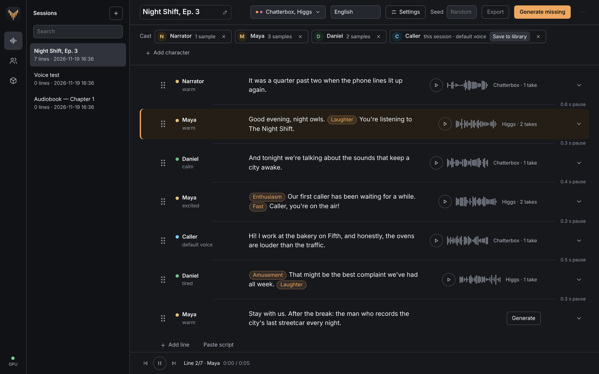

<p align="center"></p>

# Vokalit

**A local voice cloning and text-to-speech studio.** Clone a voice from a short recording, write a script with several
characters, generate takes, compare them and export the result — all on your own computer with an NVIDIA GPU.
Your voice, your text and the generated audio never leave your machine.

It is deliberately small: a few hundred KB of plain Python and JavaScript, no build step, and models chosen to run on
everyday graphics cards with **8–12 GB of video memory** (developed and measured on a 12 GB RTX 4070 SUPER).

**Listen** — two characters made with **Design voice** (OmniVoice, from a description; no one's voice was recorded), then used as
samples for a short podcast voiced with Higgs TTS 3. The second clip has the same Turkish-designed voices reading an
English script. Unmute the player to listen.

<table>
<tr><th>Turkish</th><th>English</th></tr>
<tr>
<td><video src="https://github.com/user-attachments/assets/3ae4f506-6cbf-43e7-b548-e0e4650fcc7b" controls muted width="100%"></video></td>
<td><video src="https://github.com/user-attachments/assets/9a7e00d0-6b1f-4899-ae08-8941af1a514b" controls muted width="100%"></video></td>
</tr>
</table>

<sub>Made with Boson AI's Higgs Audio.</sub>



- **Studio** — sessions with a cast of characters and a script. Generate one or more takes per line, pick the best,
  trim it, listen to the whole script with *Play all*, and export it as one file (WAV, FLAC, MP3 or OGG). Lines made
  by different models are joined at the highest sample rate among them. A single line can be exported too: the export
  button at the top of an open line, or *Export this line* in a line's menu.
- **Characters** — a library of reusable voices. Each character can have several samples (e.g. *calm*, *excited*, or
  one per language), recorded in the app or uploaded, and trimmed before saving. With OmniVoice or VoxCPM2
  installed, a voice can also be **designed** from a description (e.g. *female, elderly*): the model speaks a text in
  three voices and you keep the one you like as a sample.
- **Models** — install and remove open models with one click. Size, GPU memory, location and license are shown
  before anything is downloaded, and *Remove* frees all of it. The screen also shows which models are loaded on the
  GPU right now, with an *Unload* button.
- **Generation settings** — per model, at three levels: model defaults → session → line. A seed makes a take
  reproducible. VoxCPM2 also takes a *Style*: a few words on how the line is said (type them or pick Happy, Sad,
  Calm, …). A take in progress can be cancelled (*Cancel* next to it, or *Stop* for Generate missing); the model then
  loads again for the next take.
- **Perform this line** — record a line with your own delivery and convert it to a character's voice.
- **Dub** — drop in a video (MP4, WebM) or an audio file; Whisper finds the sentences and their times, you write the
  translations, and each sentence is spoken in the new language **in its own original voice** (cloned from that
  sentence, so every speaker keeps their voice and mood). Laid out like a subtitle editor: a compact sentence table
  with filters (untranslated, no take, too long), the video and the selected sentence beside it, and a zoomable
  timeline with the original's waveform where a translation that runs long shows red and clips can be dragged.
  *Copy for translation* copies every sentence, numbered and with its times (how long the original takes to say, and
  the most it may take), for the translation tool you like, asking for translations about as long as the original;
  *Paste translations* puts its reply back. Every new take is as loud as its sentence was spoken, and OmniVoice speaks
  it for as long as the speaker did (within 0.85x-1.25x of its natural pace). A take that still runs a little long,
  or ends while the speaker is still talking, can be **fitted**: sped up (up to 1.25x of its natural pace, counting
  OmniVoice's) or slowed down (to 0.85x), same pitch, one sentence or all of them
  from the Too long / Too short tabs; fitted sentences stay listed with their speed, can go back to the original take,
  and the rest need a shorter or longer translation. One dub can have several target languages (tabs), each with its
  own translations, takes, timing and model. Music or singing that Whisper wrote down can be marked *Keep the original here* (K): the original
  plays there at full volume in every language, and nothing is translated or generated. With **Voice separation**
  (Demucs, on the Models screen) the speech is separated from the music and effects first: voices are copied from
  clean speech, and the music stays at full level under the dub. With the **Speaker finder** (SpeechBrain ECAPA, on
  the Models screen) transcription also finds who says each sentence (a coloured chip in the table; change it in the
  sentence panel, name or merge speakers under *Speakers…*, or *Find speakers again…* with a count when the guess is
  off: its threshold is a first guess). Each sentence is then cloned from its own sound joined with the same
  speaker's nearest sentences within a minute, about 8 s (at most 10 s): a steadier voice and accent that still
  carries the moment's mood. When the original's accent carries into the dub, raise OmniVoice's **Native accent**
  setting: it leans on the text more than on the sample (more native, a little less like the speaker, about 1.5x
  slower). That costs some of the moment's mood; **Accent removal (experimental)** keeps the speaker's sample as it is
  and takes out only the accent, estimated from four short "accent voices" the dub makes once (one female and one male
  voice, each speaking the original's language and the dub's); two to three times as slow. A part Whisper missed can
  be added: drag over it on the Original lane of the timeline and press *Add sentence*; Whisper writes what it hears there (*Listen* does it
  again for any sentence), and you correct it. Start and end times can be typed in. Takes can be deleted one by one,
  or all of a tab's sentences with *Delete takes*. Every change can be undone
  (Ctrl+Z). The mix is exported as one audio file, or, with **Video export** (FFmpeg, on the Models screen), as
  the video itself with the dub as its sound (the picture copied as it is; optionally every language as its own audio
  track, then the original). The screen stays quick with tens of thousands of sentences; the
  file itself is best kept to about 20 minutes, as the window decodes its sound.
- **Languages** — per session or per line, limited to what the selected models support; a search box finds a
  language among OmniVoice's 646.
- **Tags** — sounds (laughter, sighs, …), emotions, styles and delivery (speed, pitch, pauses) as chips inside a
  line's text (*Add tag*, or type `[`; × removes one). Each model gets them in its own syntax; models that cannot
  perform a tag get the text without it, and the menus say which model performs which. Higgs TTS 3 performs
  emotions, styles, delivery and sounds; OmniVoice performs its sounds, more clearly with a higher Quality.
- **Transcripts** — every sample keeps what is said in it, which some models use to copy the voice. The optional
  Whisper component writes it for you (and detects the language); otherwise you type it.

## Screenshots

**Line details** — text with emotion and delivery tags, sample, language and pause; generate with one or more
models; per-line settings; takes to compare, trim and pick; and *Perform this line* to convert your own recording.


**Characters** — reusable voices with several labelled samples, each tagged with its language. Here a voice is
designed from a description: three candidates to listen to and keep.


**Models** — install and remove models; size, GPU memory and license are shown first, and a loaded model shows
its GPU memory and how it loaded.


<sub>Screenshots use made-up demo data; no real voices were used.</sub>

## Models

**Models are not included in the download.** The repository contains only the app (a few hundred KB). You install
the models you want from the app's **Models** screen, which shows each model's size, location and license and asks
before downloading anything. Each model goes into its own folder under `.local/`, and **Remove** deletes it again.

| Component | Languages | Disk space | License |
|---|---|---|---|
| [Whisper](https://github.com/SYSTRAN/faster-whisper) (optional, recommended) — writes sample transcripts, runs on the CPU | ~100 | ~1.7 GB | MIT |
| [Chatterbox Multilingual](https://huggingface.co/ResembleAI/chatterbox) (Resemble AI) | 23 | ~12.3 GB (measured on Windows) | MIT |
| [OmniVoice](https://huggingface.co/k2-fsa/OmniVoice) (k2-fsa) — cloning, sound tags | 646 | ~9 GB, less when Chatterbox is installed | Code Apache 2.0; **weights CC-BY-NC: no commercial use** |
| [VoxCPM2](https://huggingface.co/openbmb/VoxCPM2) (OpenBMB) — cloning, style instructions, 48 kHz | 30 | ~13.6 GB (measured on Windows), less when another model is installed | Apache 2.0 |
| [Higgs TTS 3](https://huggingface.co/bosonai/higgs-tts-3-4b) (Boson AI) — cloning, emotions, styles, sounds | 102 | ~17.9 GB (measured on Windows), less when another model is installed | **Research and non-commercial**; monetized creator content allowed with credit (below) |

Each component has its own environment, so one model's packages can never break another's. Identical files — above
all PyTorch with CUDA, about 5 GB — are stored once and shared between models; files nothing uses any more are
deleted automatically, and removing the last component frees everything.

What you do with OmniVoice's output must be non-commercial: its weights are licensed CC-BY-NC because of its training
data, and no paid license is offered.

Higgs TTS 3 is under Boson AI's research and non-commercial license. Its Creator Use Grant lets you publish and
monetize podcasts, videos and social posts made with it, provided you credit "Boson AI's Higgs Audio" in the audio or
prominently in the accompanying text; embedding it in a product or offering it as a service needs a commercial license
from Boson AI. Vokalit runs it from a community transformers packaging of the original weights, pinned to one
version.

## Requirements

- **NVIDIA GPU** with an up-to-date driver that supports CUDA 12.8. RTX 20 series or newer is a safe choice; RTX 50
  series is supported. Video memory: Chatterbox about 4 GB, OmniVoice about 2.7 GB, VoxCPM2 about 8.4 GB, Higgs TTS 3
  about 6.1 GB in 8-bit or 9.7 GB in full precision (it picks full precision when there is room, and the Models
  screen says which and why). Models left unused for 5 minutes are unloaded, and others are unloaded when one needs
  room.
  In short, from these measurements (not yet tried on an 8 GB card): with **8 GB**, Chatterbox, OmniVoice and Higgs TTS 3 (in 8-bit) run, while VoxCPM2 is tight; with
  **12 GB**, every model runs, Higgs TTS 3 in full precision when nothing else is using the GPU.
- **Windows 10/11** (tested) or **Linux** (less tested).
- An internet connection only while installing. Nothing else needs to be installed beforehand: Vokalit downloads its
  own Python and packages into its folder, and the models are installed later from inside the app.
- Disk space: a few hundred MB for the app and its Python, plus the models you choose to install (see above). The
  install confirmation shows the free space on the drive, and an install that would not fit does not start.

## Getting started

1. Download the repository (green **Code** button → **Download ZIP**) and extract it, or `git clone` it.
2. Start it:
   - **Windows:** double-click `start.bat`.
   - **Linux:** run `./start.sh`.

   The first start asks to download [uv](https://github.com/astral-sh/uv) (about 20 MB) unless you already have it.
   uv then sets up Python and the app's packages inside the folder. This takes a few minutes once.
3. In the window, open **Models** and install a model — this is the large download, and the app cannot generate
   speech until at least one model is installed. The confirmation shows the download size, where it goes and
   its license. Installing **Whisper** too saves you typing what each sample says.
4. Open **Characters**, create a character and add a sample: at least 10 seconds of clear speech. The first ~10
   seconds matter most, so trim away silence and noise. Then check what the sample says (Whisper writes it) or type
   it exactly.
5. Open **Studio**, create a session, add the character to the cast, write or paste lines (`Name: text`), and
   **Generate**.

Tips: hover over a control to see what it does. *Space* plays and pauses *Play all*; *Esc* closes a line;
*Ctrl+A* selects all lines for bulk actions.

## Privacy

Vokalit is built so that your voice cannot leave your computer.

- **The network is used only when you install something:** uv from GitHub, packages from PyPI and the PyTorch
  index, model weights from Hugging Face. Nothing is downloaded without your confirmation.
- **The models run offline.** Each model runs in its own process that blocks network connections before any library
  is loaded, with Hugging Face's offline mode on. Everything a model needs at generation time is downloaded during
  install.
- **The window talks only to the app on your computer** (`127.0.0.1`, a random port, a per-run token). The page loads
  nothing from the internet.
- **The microphone** is used only while you record. The window asks once; after you allow it, it is not asked again
  (if you block it, it asks again on the next start).
- **Higgs TTS 3 runs code that comes with its download** (a community transformers packaging of Boson AI's weights).
  It is pinned to one version, so it cannot change after you install it, and it runs offline like the other models.
- **Check it yourself:** after installing a model, disconnect from the internet and keep working — everything works.
  While generating, Windows Resource Monitor (Network tab) or `ss -tnp` on Linux shows no connection other than
  `127.0.0.1`.
- **Your data is stored unencrypted** in the `workspace/` folder (characters, samples, sessions, takes, recordings,
  exports) until you delete it. Delete the folder to remove everything.
- **Known limit:** on Windows the window is drawn by Microsoft Edge WebView2, which may send its own diagnostic data
  to Microsoft. Audio content is not part of it.

## Responsible use

- Only use your own voice, or voices you have clear permission to use.
- Do not use cloned voices to deceive or impersonate anyone. What you do with the audio you generate is your
  responsibility.
- Chatterbox adds an inaudible watermark (Resemble AI's PerTh) to what it generates. Vokalit does not disable it;
  please do not remove it.
- When reporting a problem, do not attach other people's recordings.

## Where things are

Everything stays inside the Vokalit folder; deleting the folder removes all of it.

```
.local/            uv, Python, the app environment, window data, and one folder per installed model
workspace/         your characters, sessions, dubs, takes, recordings and exports
```

Use the folder button next to a sample, take or export to show it in File Explorer.

## Troubleshooting

- **The window closes right away on Windows:** run `start.bat` from a Command Prompt to read the error.
- **"The GPU stopped with an internal error":** a CUDA error stopped the model, so it was restarted automatically.
  Try again; if it repeats with the same settings, lower *Variation* or *Expressiveness*, or use another seed.
- **Long lines get cut off or drift:** models work best with a sentence or two per line. Use *Split into N lines*.
- **A take takes a long time:** press *Cancel* next to it (or *Stop* for Generate missing). Higgs TTS 3 in 8-bit
  needs about 4 seconds per second of speech; the Models screen says whether it runs in 8-bit and why. Close other
  programs that use the GPU and *Unload* it, and it loads in full precision (about three times faster) when there is
  room.
- **"Not enough GPU memory":** the model did not fit even after the others were unloaded, often because another line
  is generating with a different model at the same time. Generate with one model at a time, or close other programs
  that use the GPU.
- **An accent from another language:** use a sample in the line's language, or *Reduce accent* in the line.
- **Linux: the window does not open:** the Qt web engine may need system libraries; the console names the missing
  one. Install it with your package manager.

## Development

```
python3 -m pytest tests -q              # Python tests (no GPU or network needed; models are stubbed)
node --test "app/ui/tests/*.test.mjs"   # interface helpers
```

The interface is plain HTML, CSS and JavaScript modules in `app/ui/` (no build step, no CDN); the local server is
`app/server.py`, storage is `app/workspace.py`, and each model has a worker in `workers/<model>/`.
[SPEC.md](SPEC.md) describes the design, and [docs/workspace-design.md](docs/workspace-design.md) the workspace in
detail.

## License

[MIT](LICENSE): use, change and share it freely, including commercially; keep the copyright and license notice
in copies. The models and libraries it downloads have their own licenses, shown before installing.
